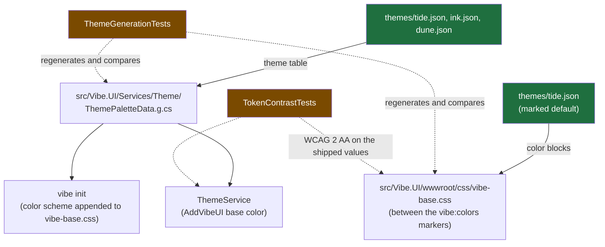

# Theme definitions

*Last updated 2026-11-22.*

Every color Vibe.UI ships is defined once, in this folder. Nothing else in the repository
holds a palette by hand.



## Files

Each `*.json` file is one built-in theme, selectable by its `name` as the base color.
Exactly one has `"default": true`. That theme supplies the stylesheet's colors, is the base
color when none is chosen, and is what a custom theme starts from.

A definition has a `name` and two objects, `light` and `dark`. Each maps a token name (the
part after `--vibe-`) to an `hsl(H S% L%)` value. Tokens are written out in file order.

Every theme defines the same tokens in the same order in both modes: the 19 that shadcn/ui
themes also use, then the roles (sunken border, link, status text and soft tints), the
status fills, the sidebar and the chart colors. A test fails if a theme leaves one out.

## Changing a color

1. Edit the value in the definition.
2. Regenerate the checked-in files:

   ```bash
   UPDATE_GENERATED_THEMES=true dotnet test tests/Vibe.UI.Tests --filter ThemeGeneration
   ```

3. Run the tests without the variable. `TokenContrastTests` fails if a pair drops below
   WCAG 2 AA (4.5:1 for text, 3:1 for control boundaries and the focus ring).
4. Rebuild the docs so their generated stylesheet picks the colors up, and commit everything.

Editing `vibe-base.css` between the markers, or `ThemePaletteData.g.cs`, by hand fails
`ThemeGenerationTests`, which names the first line that differs.

## Adding a theme

Copy an existing definition to `themes/<name>.json`, change the name and the colors, remove
`"default": true`, and regenerate. It becomes a valid base color for `AddVibeUI` and a choice
in `vibe init` with no other change, and the contrast tests measure it.

## The layer model

Recorded 2026-11-21, so the reasoning is not lost. The themes are Vibe.UI's own. They
replaced six palettes ported from shadcn/ui on 2026-11-22.

| Level | Surface | Token | Light | Dark |
| --- | --- | --- | --- | --- |
| 0 | Sunken (wells, code) | `--vibe-muted` | Grey just below the page, plus a border | Darkest step |
| 1 | Page | `--vibe-background` | Base grey, about 80% lightness | Next step up |
| 2 | Card, app bar, sidebar, table header | `--vibe-card` | White | Next step up |
| 3 | Popover, menu, dialog | `--vibe-popover` | White, lifted by shadow | Lightest step |

Why the modes differ: on a light theme there is no room above white, and fill steps small
enough to keep the page near white (under about 1.08:1 between neighbours) cannot be seen.
So light uses two fills and tells the levels apart with borders and shadow. On a dark theme
lightness steps read clearly and shadows barely show, so dark uses four fills.

## Known gaps

- The gap inside a focus ring is drawn in the page color, whatever the control sits on.
- The docs site's own pages are written with fixed zinc utility classes, so its panels stay
  neutral grey while the page and the components take the theme.
