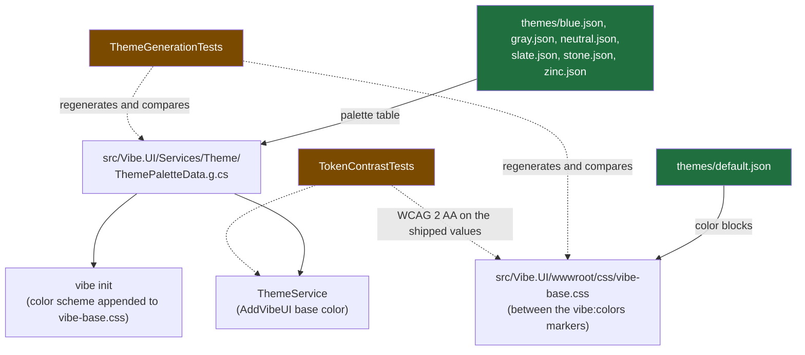

# Theme definitions

*Last updated 2026-11-21.*

Every color Vibe.UI ships is defined once, in this folder. Nothing else in the repository
holds a palette by hand.



## Files

| File | What it defines |
| --- | --- |
| `default.json` | The colors in `vibe-base.css`: what a project gets with no base color chosen |
| any other `*.json` | A built-in palette, selectable by its `name` as the base color |

A definition has a `name` and two objects, `light` and `dark`. Each maps a token name (the
part after `--vibe-`) to an `hsl(H S% L%)` value. Tokens are written out in file order.

A palette defines exactly the 19 tokens the theme service writes. `default.json` defines
those plus the status, sidebar and chart colors.

## Changing a color

1. Edit the value in the definition.
2. Regenerate the checked-in files:

   ```bash
   UPDATE_GENERATED_THEMES=true dotnet test tests/Vibe.UI.Tests --filter ThemeGeneration
   ```

3. Run the tests without the variable. `TokenContrastTests` fails if a pair drops below
   WCAG 2 AA (4.5:1 for text, 3:1 for control boundaries and the focus ring).
4. Rebuild the docs so their generated stylesheet picks the colors up, and commit everything.

Editing `vibe-base.css` between the markers, or `ThemePaletteData.g.cs`, by hand fails
`ThemeGenerationTests`, which names the first line that differs.

## Adding a palette

Add `themes/<name>.json` with the 19 palette tokens in both modes and regenerate. It becomes
a valid base color for `AddVibeUI` and a choice in `vibe init` with no other change.

## Where this is going

Recorded 2026-11-21, so the reasoning is not lost.

The six palettes here are shadcn/ui's original HSL themes with contrast fixes. The plan is
to replace them with a small set of Vibe.UI's own, built on a layer model that differs
between modes on purpose:

| Level | Surface | Token | Light | Dark |
| --- | --- | --- | --- | --- |
| 0 | Sunken (wells, code) | `--vibe-muted` | Grey just below the page, plus a border | Darkest step |
| 1 | Page | `--vibe-background` | Base grey, about 80% lightness | Next step up |
| 2 | Card, app bar, sidebar, table header | `--vibe-card` | White | Next step up |
| 3 | Popover, menu, dialog | `--vibe-popover` | White, lifted by shadow | Lightest step |

Why the modes differ: on a light theme there is no room above white, and fill steps small
enough to keep the page near white (under about 1.08:1 between neighbours) cannot be seen.
So light uses two fills and tells the levels apart with borders and shadow. On a dark theme
lightness steps read clearly and shadows barely show, so dark uses four fills.

Order of work:

1. One source for every color, generated and gated (done: this folder).
2. Add the new themes as definitions. They need the role tokens (`--vibe-sunken-border`,
   `--vibe-link`, status `-text` and `-soft`) to carry their own values.
3. Move the components onto the roles, then switch the defaults. Until then the new themes
   would look wrong: about 29 component rules use `--vibe-muted` as a hover fill and 64 use
   `--vibe-background` as a fill, which a grey page and a darker sunken surface would change.
